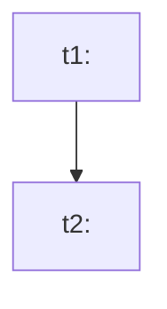

# Ticket Plan

<!--
Fixed response contract. Every agent emits these sections, labels, columns and
vocabulary in this order so plans stay comparable across agents and runs.
Never rename, reorder or drop a heading, summary label or table column, and
emit none of the text inside these comments.

Markers, used exactly:
- `None observed.` is the whole body of an in-scope section with nothing to show.
- `none` fills a summary value, list item or table cell with nothing to show.
- `unknown` fills a value that could not be established. Never leave it blank.

Use repository-relative paths; never include secrets, credentials, credential-bearing
URLs, absolute local paths or personal identifiers.
-->

<!--
Plan status: `draft` (not yet validated), `invalid` (graph or coverage defects
listed under Plan Defects), `awaiting approval` (valid, shown to the user),
`approved` (user approved), `in execution` or `complete`.
Ticket status: `planned`, `in progress`, `in review`, `changes requested`,
`approved`, `integrated` or `blocked`.
Security review: `required` or `not required`.
-->

## Summary

- **Plan status:** <draft | invalid | awaiting approval | approved | in execution | complete>
- **Spec:** <repository-relative spec path>
- **Revision:** <short SHA of the planning base>
- **Tickets:** <count>
- **Waves:** <count>

## Agent Assignment

| Role | Agent | Chosen by |
| --- | --- | --- |
| Planner | <agent or profile> | <user> |
| Developer | <agent or profile> | <user> |
| Reviewer | <agent or profile> | <user> |
| Security reviewer | <agent, profile or `none`> | <user> |

## Tickets

| ID | Outcome | Depends on | Criteria | File scope | Validation | Security review | Status |
| --- | --- | --- | --- | --- | --- | --- | --- |
| t1 | <one bounded outcome> | <ticket IDs or `none`> | <AC IDs> | <paths> | <task commands> | <required or not required> | <status> |

## Execution Graph

## Waves

| Wave | Tickets | Parallel | Note |
| --- | --- | --- | --- |
| 1 | <ticket IDs> | <yes, separate worktrees, or no> | <note or `none`> |

## Acceptance Coverage

| Criterion | Tickets |
| --- | --- |
| <AC ID> | <ticket IDs or `none`> |

## Plan Defects

<!-- Duplicate IDs, unknown dependencies, cycles, uncovered criteria, scopes
outside the spec's affected areas and overlapping scopes without isolation.
A valid plan uses `None observed.` as the whole body. -->

| Defect | Tickets | Required change |
| --- | --- | --- |
| <defect> | <ticket IDs> | <change> |
